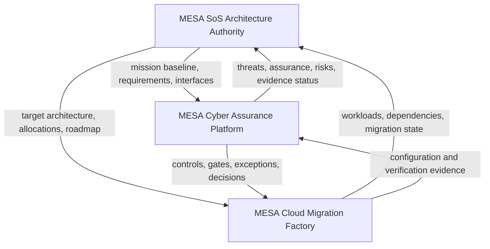

# MESA System-of-Systems Architecture

## Purpose

This constituent project defines the mission and architecture authority for the integrated MESA ecosystem. It converts mission outcomes into operational threads, requirements, functions, logical systems, information exchanges, interfaces, performance constraints, verification claims, and capability roadmaps.

It coordinates—but does not replace—the MESA Cyber Assurance Platform and MESA Cloud Migration Factory.

## Mission outcome

Provide an authoritative, traceable architecture baseline that enables independently managed constituent systems to collaborate toward a shared mission outcome while preserving ownership, interface accountability, security, resilience, and lifecycle governance.

## Architecture scope

- Mission outcomes, stakeholders, actors, external systems, and system context
- Operational threads, use cases, functions, behaviors, states, and failure modes
- Logical constituent systems and shared services
- Interface and information-exchange governance
- Requirements, allocations, quality attributes, constraints, and tradeoffs
- End-to-end traceability and architecture decisions
- Capability roadmap, backlog translation, verification, and sustainment

## Constituent-system relationship

## Architecture deliverables

- `docs/01-Mission-Context-and-CONOPS.md`
- `docs/02-Operational-Threads.md`
- `docs/03-Functional-and-Logical-Architecture.md`
- `docs/04-Interfaces-and-Information-Exchanges.md`
- `docs/05-Quality-Security-and-Resilience.md`
- `docs/06-Verification-Governance-and-Sustainment.md`
- `docs/07-Capability-Roadmap.md`
- `interfaces/openapi.yaml`
- `traceability/architecture-traceability.csv`
- `verification/systems-test-plan.md`
- `verification/threat-scenarios.md`
- `verification/risk-registry.md`
- `backlog/epics-and-stories.md`

## Architecture principles

- Mission outcome before technology selection
- Constituent-system autonomy with explicit interface accountability
- Authoritative sources and governed shared services
- API/event integration rather than shared-database coupling
- Zero trust and evidence provenance across boundaries
- Incremental capability delivery with verified mission threads
- Human accountability for baselines, residual risk, and mission decisions

## Public-safety note

All content is synthetic and intended for unrestricted public portfolio use. It contains no actual customer, employer, program, classified, CUI, export-controlled, or proprietary information.
