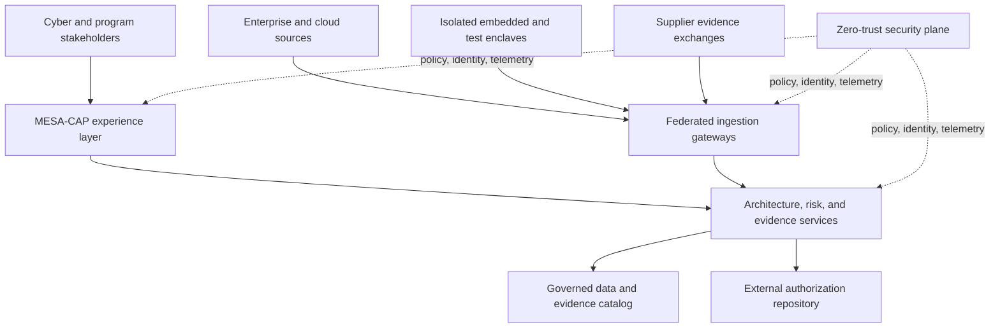

# MESA Cyber Assurance Platform (MESA-CAP)

> A notional, public-safe architecture portfolio case study. All organizations, systems, data, interfaces, threats, controls, and evidence are synthetic. This repository contains no customer, employer, classified, CUI, export-controlled, or proprietary information.

## Executive summary

MESA-CAP is a reference IT system for governing cybersecurity architecture and authorization evidence across a portfolio of connected mission systems. It links embedded platforms, ground and test environments, enterprise services, approved cloud analytics, suppliers, and authorization stakeholders without assuming that every environment can be directly connected.

The system gives a Lead Cyber Architect a defensible way to answer five questions:

1. What mission capability and assets are at risk?
2. Which threats, trust boundaries, interfaces, and dependencies drive that risk?
3. Which requirements and controls mitigate it, and who owns them?
4. Is the evidence current and sufficient for the claimed assurance?
5. What residual risk, cost, schedule, and mission tradeoffs require a decision?

This is an architecture case study, not an authorization package and not production software. It demonstrates systems security engineering (SSE), RMF/A&A architecture, zero-trust design, embedded/OT integration, evidence governance, cyber test strategy, and senior-level trade decisions.

## Mission outcome

Enable a mission-system portfolio to make timely, evidence-based cyber risk decisions while preserving isolation, safety, availability, configuration control, and authorization boundaries.

### Measures of effectiveness

| Measure | Notional target | Why it matters |
|---|---:|---|
| Critical asset coverage | 100% mapped to owner, boundary, threats, requirements, and evidence | Prevents unknown assurance gaps |
| Evidence freshness | 95% within defined validity period | Reduces decisions based on stale evidence |
| High-risk finding triage | 90% within 1 business day | Supports operational urgency |
| Authorization dependency visibility | 100% of external/common services mapped | Exposes inherited-risk dependencies |
| Traceability completeness | 95% of priority requirements linked end to end | Makes assurance claims reviewable |
| Disconnected-operation continuity | 72 hours for enclave collectors | Accommodates constrained mission environments |

## MESA method applied

MESA is the governing architecture workflow used in this case study.

| MESA step | Repository evidence |
|---|---|
| 1. Mission need and CONOPS | `docs/01-Mission-CONOPS.md` |
| 2. Stakeholders and SoS context | `docs/02-Stakeholders-and-Context.md` |
| 3. Drivers and alternatives | `docs/03-Drivers-and-Trade-Study.md` |
| 4. Requirements engineering | `docs/04-Cybersecurity-Requirements.md` |
| 5. Functional and behavioral analysis | `docs/05-Functional-and-Behavioral-Analysis.md` |
| 6. Logical architecture | `docs/06-Logical-Architecture.md` |
| 7. Interfaces, data, and zero trust | `docs/07-Interfaces-Data-and-Zero-Trust.md` |
| 8. Capability roadmap | `docs/08-Capability-Roadmap.md` |
| 9-10. Epics and stories | `docs/09-Backlog-Translation.md` |
| 11. Verification and validation | `docs/10-Verification-and-Validation.md` |
| RMF integration | `docs/11-RMF-and-Authorization-Strategy.md` |
| 12. Governance and sustainment | `docs/12-Governance-and-Sustainment.md` |

## System concept

### Core capabilities

- Architecture and asset inventory with boundary and dependency mapping
- Threat-informed requirements and mission-thread risk analysis
- Control tailoring, allocation, inheritance, and responsibility mapping
- Evidence catalog with provenance, validity periods, markings, and assurance claims
- SSP, SCTM, POA&M, decision, and continuous-monitoring workflows
- Cyber test planning and verification traceability
- Portfolio risk, authorization dependency, and residual-risk dashboards
- Disconnected collection for isolated embedded/OT and test environments

## Architectural position

- **Hybrid by constraint:** management services can operate in an approved cloud or data center; isolated enclaves use controlled collectors and release workflows.
- **Zero trust by resource:** access decisions consider subject, device/workload, resource, purpose, environment, and current risk—not network location alone.
- **Federated evidence:** source systems remain authoritative; MESA-CAP catalogs provenance and stores only approved evidence copies or references.
- **API plus events:** synchronous APIs support authoritative queries and decisions; events distribute findings, evidence changes, and workflow state.
- **Human accountability:** automation recommends, validates, and routes; designated officials accept risk and approve authorization decisions.

## Principal architect decisions demonstrated

| Decision area | Architecture response | Artifact |
|---|---|---|
| Embedded/enterprise separation | Segregated collectors with store-and-forward and controlled release | `ADR-005` |
| Control inheritance | Explicit provider, consumer, validation, and dependency records | RMF matrices |
| Evidence sufficiency | Provenance, coverage, freshness, integrity, and reviewer confidence rubric | Evidence rubric |
| Mission/cost/schedule tradeoffs | Weighted alternatives plus documented assumptions and residual risk | Trade study |
| Authorization dependencies | Boundary and common-service graph with failure impacts | RMF strategy |
| Continuous monitoring | Risk-tiered signals, thresholds, owners, and response times | Monitoring strategy |
| Interface risk | Versioned APIs/events, schema checks, replay protection, and failure handling | Interface contracts |

## Traceability example

`Mission outcome MO-01` → `Scenario SC-03` → `Requirement CYR-014` → `Function LF-07` → `Interface IF-06` → `Control allocation CA-07` → `Story US-09` → `Verification VT-014` → `Evidence EV-SYN-014` → `Decision DR-03`

## Five-minute portfolio walkthrough

1. State the mission outcome and constraints in 30 seconds.
2. Use the context and logical diagrams to explain boundaries and responsibilities.
3. Walk one risk thread from threat to requirement, architecture control, test, evidence, and residual-risk decision.
4. Explain why the design uses hybrid deployment, federated evidence, and segregated collectors.
5. Close with the roadmap and how architecture governance prevents drift.

See `docs/13-Interview-Walkthrough.md` for a reusable script.

## Repository map

- `docs/` — MESA architecture narrative and interview walkthrough
- `diagrams/` — editable Mermaid source
- `architecture-decisions/` — consequential decisions and tradeoffs
- `interfaces/` — notional API and event contracts
- `schemas/` — synthetic JSON schemas and example records
- `rmf/` — reusable, non-authoritative RMF working templates
- `verification/` — threats, test approach, and verification crosswalk
- `backlog/` — capability increments, epics, and stories

## Standards basis

- NIST SP 800-160 Vol. 1 Rev. 1, *Engineering Trustworthy Secure Systems*
- NIST SP 800-37 Rev. 2, *Risk Management Framework for Information Systems and Organizations*
- NIST SP 800-53 Rev. 5, *Security and Privacy Controls for Information Systems and Organizations*
- NIST SP 800-207, *Zero Trust Architecture*

These references inform the example. No control selection or template in this repository should be treated as an approval, compliance determination, or substitute for an organization-specific process.

## Use and attribution

Copyright 2026 Joseph J. Brooks. Released under the MIT License. If adapting this portfolio, replace the author, assumptions, and scenario with your own public-safe material.
