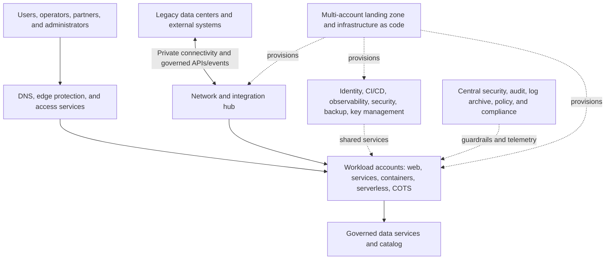

# MESA Cloud Migration Factory

> A synthetic, public-safe architecture case study for migrating a mixed portfolio of enterprise and mission-support systems into a secure AWS-like cloud environment. No customer, employer, classified, CUI, export-controlled, or proprietary information is included.

## Executive summary

The MESA Cloud Migration Factory is a governed system-of-systems architecture for assessing, sequencing, migrating, validating, and sustaining an application portfolio in a secure cloud. It combines a multi-account landing zone, hybrid connectivity, federated identity, zero-trust access, reusable platform services, automated provisioning, centralized observability, data governance, cyber assurance, FinOps, and wave-based migration execution.

The architecture does **not** assume that every system should be rehosted unchanged. Every system receives an accountable disposition: retire, retain temporarily, rehost, relocate, repurchase, replatform, or refactor. The program outcome is portfolio-wide cloud transformation—not indiscriminate lift-and-shift.

## Mission outcome

Migrate all eligible systems to a governed cloud platform while preserving mission continuity, data integrity, security posture, performance, recoverability, and traceable decision authority.

### Success measures

| Measure | Notional target |
|---|---:|
| Portfolio systems with approved disposition | 100% |
| Critical dependencies mapped before wave approval | 100% |
| Workloads passing security and operational readiness gates | 100% |
| Priority mission-thread regression tests passed | ≥99% |
| Unplanned Tier 1 cutover outage | 0 |
| Recovery objectives demonstrated before production | 100% of Tier 1/2 workloads |
| Resources deployed through approved infrastructure as code | ≥95% |
| Monthly cloud cost allocated to owner/product | ≥98% |
| Legacy hosting retired after accepted stabilization | 100% of migrated workloads unless exception approved |

## MESA lifecycle applied

| MESA step | Cloud-migration application | Repository evidence |
|---|---|---|
| 1. Mission need and CONOPS | Transformation outcome and operating concept | `docs/01-Mission-and-CONOPS.md` |
| 2. Stakeholders and context | Portfolio, owners, external services, constraints | `docs/02-Portfolio-Discovery.md` |
| 3. Drivers and alternatives | Cloud strategy and migration dispositions | `docs/03-Target-Cloud-Architecture.md` |
| 4. Requirements | Functional and quality requirements | `docs/04-Architecture-Requirements.md` |
| 5. Functional/behavioral analysis | Migration factory workflow | `docs/05-Migration-Factory-Workflow.md` |
| 6. Logical architecture | Landing zone and platform services | `docs/06-Landing-Zone-and-Platform.md` |
| 7. Interfaces, data, zero trust | Network, security, data, integration | `docs/07-Security-Network-and-Data.md` |
| 8. Capability roadmap | Foundation, pilots, waves, modernization | `docs/08-Capability-Roadmap.md` |
| 9–10. Epics and stories | Migration backlog | `backlog/epics-and-stories.md` |
| 11. Verification/validation | Workload and platform readiness | `docs/11-Verification-and-Validation.md` |
| 12. Governance/sustainment | Cloud operating model, FinOps, optimization | `docs/12-Governance-FinOps-and-Sustainment.md` |

## Reference architecture

## Target cloud organization

- **Management:** organization and account lifecycle only; no workloads
- **Security:** audit, security tooling, log archive, incident response
- **Infrastructure:** network hub, DNS, connectivity, shared ingress/egress
- **Shared Services:** identity integration, CI/CD, artifact registry, observability, backup
- **Workloads:** separate development, test, staging, and production accounts by product or boundary
- **Sandbox:** restricted experimentation with budgets and expiration
- **Suspended/Quarantine:** isolated accounts pending remediation or closure

## Portfolio archetypes

| Archetype | Typical disposition | Target pattern |
|---|---|---|
| Legacy web application | Replatform, then refactor | Managed load balancing, containers or managed runtime, managed database |
| COTS business application | Repurchase or rehost | SaaS where appropriate; isolated compute otherwise |
| Data and analytics platform | Replatform/refactor | Object storage, governed catalog, managed processing and analytics |
| Event-driven services | Refactor | API gateway, event bus, queues, functions/containers |
| Batch and integration jobs | Replatform | Managed scheduling, workflow orchestration, object storage |
| Specialized/latency-bound system | Retain temporarily | Hybrid connectivity and explicit exit criteria |

## Principal architecture decisions

| Decision | Rationale | Record |
|---|---|---|
| Multi-account landing zone | Isolation, ownership, policy, billing, reduced blast radius | `ADR-001` |
| Federated workforce/workload identity | Central lifecycle and short-lived access | `ADR-002` |
| Hub-and-spoke hybrid network | Governed connectivity with workload isolation | `ADR-003` |
| Infrastructure and policy as code | Repeatability, reviewability, drift control | `ADR-004` |
| Migrate first, modernize by value | Controls migration complexity and preserves momentum | `ADR-005` |
| Central observability with local ownership | Portfolio awareness without removing product accountability | `ADR-006` |

## Migration wave model

1. **Wave 0 — Foundation:** landing zone, identity, network, security, operations, IaC.
2. **Wave 1 — Pilot:** low-dependency systems that exercise end-to-end controls.
3. **Wave 2 — Shared services:** integration, data, and common services needed by later waves.
4. **Wave 3 — Business applications:** moderate-complexity web, COTS, and batch workloads.
5. **Wave 4 — Data and analytics:** governed migration of high-volume and high-dependency data.
6. **Wave 5 — Mission-critical systems:** rehearsed cutovers with demonstrated recovery.
7. **Wave 6 — Modernize and exit:** refactor priority systems and retire legacy hosting.

## Traceability example

`Mission Outcome MO-01` → `Operational Thread OT-02` → `Requirement CLR-018` → `Capability CAP-SEC-03` → `Architecture Decision ADR-002` → `Wave W1` → `Story US-014` → `Verification VT-018` → `Evidence EV-SYN-018` → `Cutover Decision CD-04`

## Repository map

- `docs/` — MESA architecture narrative and interview walkthrough
- `diagrams/` — editable Mermaid architecture sources
- `architecture-decisions/` — major design choices and consequences
- `templates/` — inventory, assessment, wave, cutover, rollback, and risk artifacts
- `interfaces/` — API/event and hybrid-integration principles
- `schemas/` — synthetic workload and migration records
- `verification/` — readiness gates and test crosswalk
- `backlog/` — roadmap, epics, and representative stories
- `iac/` — non-deployable infrastructure-as-code design example

## Five-minute portfolio walkthrough

1. State the mission outcome and why “move everything” still requires workload disposition decisions.
2. Explain the landing zone, organizational units, accounts, identity, and network boundaries.
3. Walk one system from discovery through 7R decision, dependency mapping, wave placement, cutover, verification, and legacy retirement.
4. Defend the two-phase “migrate, then modernize” decision and its exceptions.
5. Close with governance, operational ownership, FinOps, and continuous optimization.

See `docs/13-Interview-Walkthrough.md`.

## Public references

- AWS Cloud Adoption Framework: https://docs.aws.amazon.com/whitepapers/latest/overview-aws-cloud-adoption-framework/welcome.html
- AWS Well-Architected Framework: https://docs.aws.amazon.com/wellarchitected/latest/userguide/waf.html
- AWS migration strategies: https://docs.aws.amazon.com/prescriptive-guidance/latest/large-migration-guide/migration-strategies.html
- AWS multi-account landing-zone guidance: https://docs.aws.amazon.com/controltower/latest/userguide/aws-multi-account-landing-zone.html
- NIST SP 800-207, Zero Trust Architecture: https://csrc.nist.gov/pubs/sp/800/207/final

This case study is vendor-neutral. AWS-like service mappings are illustrative and not deployment instructions.

## License

Copyright 2026 Joseph J. Brooks. Released under the MIT License.
