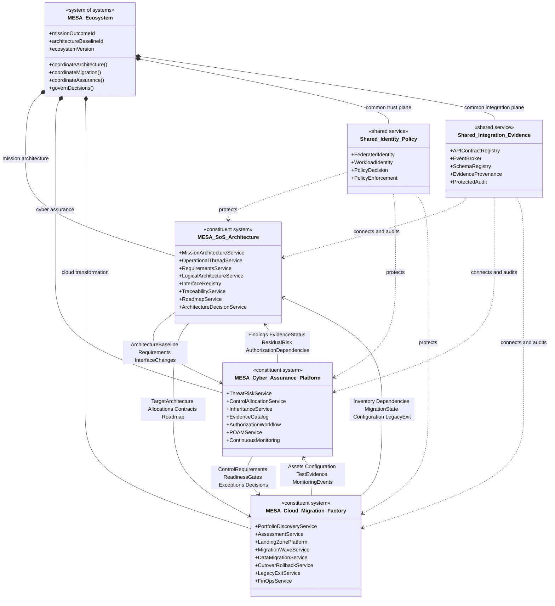

# MESA Ecosystem Block Definition Diagram

## Purpose

This SysML-inspired Block Definition Diagram defines the three constituent systems, their principal parts, and their system-of-systems relationships. Mermaid class notation is used because GitHub renders it natively.

## Block responsibilities

| Block | Owns authoritative state for | Does not own |
|---|---|---|
| MESA SoS Architecture | Mission outcomes, operational threads, requirements, functions, logical systems, architecture interfaces, baselines, ADRs | Control assessment, cloud execution, cutover authority |
| MESA Cyber Assurance Platform | Threat/risk analysis, control allocation/inheritance, evidence sufficiency, findings, authorization workflow, continuous-monitoring posture | Mission baseline approval, workload migration execution |
| MESA Cloud Migration Factory | Workload inventory, 7R assessment, landing-zone delivery, migration waves, cutover execution, legacy exit, FinOps | Mission requirement authority, residual-risk acceptance |
| Shared Identity/Policy | Federated subject/workload identities and policy decisions | Business/mission approval |
| Shared Integration/Evidence | Contract/schema registry, event transport, provenance, protected audit | Source-system business truth |

## Required interfaces

| Interface | Producer | Consumer | Pattern |
|---|---|---|---|
| Architecture Baseline API/Event | SoS Architecture | Cyber Assurance, Cloud Migration | REST + signed event |
| Workload/Dependency API/Event | Cloud Migration | SoS Architecture, Cyber Assurance | REST + signed event |
| Control and Readiness API/Event | Cyber Assurance | Cloud Migration, SoS Architecture | REST + signed event |
| Evidence API/Event | All systems | Cyber Assurance catalog; authorized reviewers | REST + signed event/reference |
| Decision API/Event | Named authorities through owning system | All affected systems | Human-approved REST command + event |
| Trace Query | SoS Architecture | All systems | REST query |

## Emergent capability

No constituent system alone can provide the full outcome. The ecosystem’s emergent capability is an evidence-driven path from mission need through architecture, secure cloud transformation, verification, residual-risk decision, and lifecycle monitoring.
