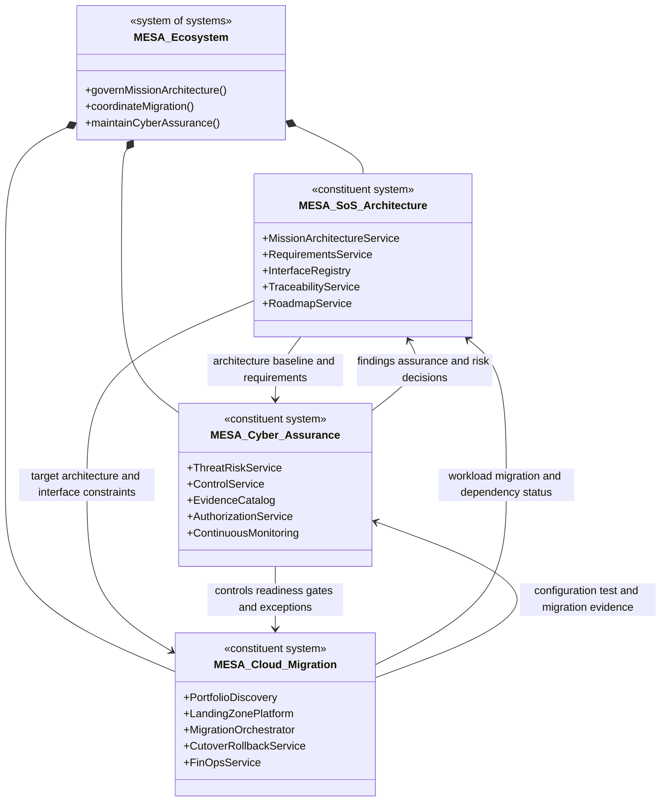

# Project MESA — Integrated System of Systems

> A public-safe architecture portfolio containing three interoperable MESA systems: mission architecture, cyber assurance, and cloud migration. All organizations, systems, data, interfaces, threats, risks, controls, evidence, and identifiers are synthetic.

## System-of-systems mission

Provide a governed digital architecture ecosystem that can define mission capabilities, migrate constituent systems into a secure cloud, and continuously assess cyber assurance without losing end-to-end traceability or human decision authority.

## Constituent systems

| Directory | Constituent system | Primary responsibility | Publishes | Consumes |
|---|---|---|---|---|
| `01-mesa-system-of-systems-architecture/` | MESA SoS Architecture | Mission outcomes, operational threads, requirements, logical architecture, interface governance, capability roadmap | Architecture baselines, requirements, interface contracts, dependency changes | Migration status, assurance evidence, risks, decisions |
| `02-mesa-cyber-assurance-platform/` | MESA Cyber Assurance Platform | Threats, control allocation/inheritance, evidence provenance, authorization support, continuous monitoring | Assurance posture, findings, evidence status, residual-risk decisions | Architecture elements, assets, dependencies, migration/configuration events |
| `03-mesa-cloud-migration-factory/` | MESA Cloud Migration Factory | Portfolio discovery, 7R disposition, landing zone, migration waves, cutover, rollback, legacy exit, FinOps | Workload records, migration state, configuration, test evidence, cost and operational status | Architecture requirements, security policies, assurance gates, risk decisions |

## Top-level block definition diagram



Detailed BDD: [`MESA_ECOSYSTEM_BDD.md`](MESA_ECOSYSTEM_BDD.md)

## Interoperability contract

All three systems share:

- Canonical identifiers for mission outcomes, operational threads, requirements, systems, workloads, interfaces, controls, tests, evidence, risks, decisions, and migration waves
- Federated OAuth/OIDC-like identity with workload identities and short-lived authorization
- Resource and purpose-based zero-trust policy
- Versioned REST APIs for authoritative commands and queries
- Signed, versioned events for asynchronous state change
- Idempotency, correlation IDs, provenance, immutable evidence IDs, and protected audit
- Explicit source authority and conflict-resolution rules
- Human approval for architecture baselines, residual risk, cutover, and authorization decisions

See [`INTEROPERABILITY.md`](INTEROPERABILITY.md), [`ecosystem-event-contracts.md`](ecosystem-event-contracts.md), and [`ecosystem-openapi.yaml`](ecosystem-openapi.yaml).

## End-to-end operational thread

1. MESA SoS Architecture approves a mission outcome, operational thread, requirements, interfaces, and target architecture.
2. Cloud Migration Factory discovers affected systems and dependencies and proposes disposition/waves.
3. Cyber Assurance evaluates threats, control allocation, evidence requirements, and authorization dependencies.
4. Architecture governance approves the coordinated baseline.
5. Cloud Migration builds and rehearses the target environment and publishes configuration/test evidence.
6. Cyber Assurance validates evidence sufficiency and publishes readiness, findings, and residual-risk recommendations.
7. Named authorities approve or delay cutover.
8. Migration Factory cuts over, validates, stabilizes, and retires legacy hosting.
9. All three systems monitor change; material changes reopen affected requirements, evidence, risks, and decisions.

## Shared traceability

```text
Mission Outcome
  → Operational Thread
  → Requirement
  → Function / Constituent System / Interface
  → Control and Migration Capability
  → Epic / Story
  → Verification
  → Evidence
  → Risk and Decision
  → Monitoring Trigger
```

## Top-level interoperability artifacts

- `MESA_ECOSYSTEM_BDD.md` — constituent blocks, parts, relationships, and required interfaces
- `INTEROPERABILITY.md` — canonical IDs, authority, conflict resolution, compatibility, and degraded operation
- `ecosystem-openapi.yaml` — cross-system status, trace, impact, and decision API
- `ecosystem-event-contracts.md` — architecture, assurance, migration, evidence, and decision events
- `ecosystem-event.schema.json` — shared signed-event envelope
- `ecosystem-traceability.csv` — cross-system trace example
- `ecosystem-test-plan.md` — interoperability and degraded-operation verification
- `threat-scenarios.md` — system-of-systems cyber and failure scenarios
- `risk-registry.md` — cross-system architecture risks
- `integration-governance.md` — decision rights and interface-change governance

## Repository-level verification

- BDD and canonical-data-model review
- OpenAPI/YAML and JSON-schema validation
- Producer/consumer contract tests
- Event replay, duplication, ordering, and reconciliation tests
- Cross-system identity and authorization tests
- End-to-end mission/migration/assurance thread
- Evidence provenance and decision-authority tests
- Degraded constituent-system and recovery tests

See `ecosystem-test-plan.md`.

## Public release

This repository does not represent an actual program, customer environment, authorization package, cloud account, vulnerability, or production architecture. Do not add classified information, CUI, export-controlled material, credentials, real network/account identifiers, customer data, employer work product, or proprietary information.

## License

Copyright 2026 Joseph J. Brooks. Released under the MIT License.
